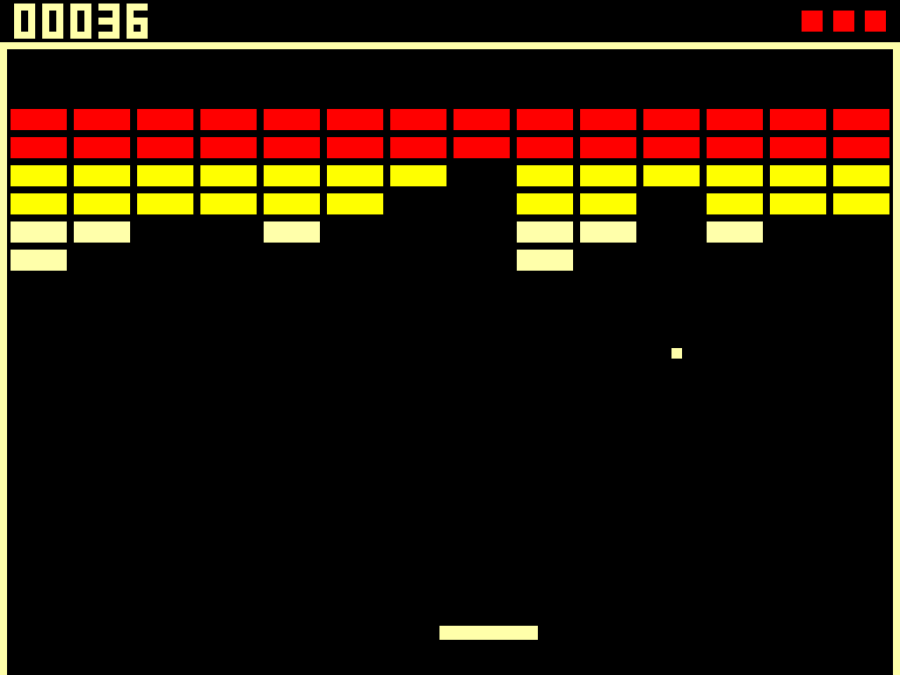

# Breakout for TinyQV

The classic brick-breaking game, running on a Tiny Tapeout chip: TinyQV "Asteroids" (`tt_um_tt_tinyQV`,
#495 on ttsky25a), Mike Bell's crowdsourced RISC-V SoC. It shows a 256x192 picture on a VGA monitor, reads an
SNES-style controller through the Gamepad Pmod and plays chiptune sound effects through an optional Audio Pmod.

## What it is

- Six rows of bricks, three lives, and a ball that speeds up as you go. Where the ball hits the paddle sets
  its angle.
- Without a controller it plays itself, so it also works as a demo.
- Sound effects for the paddle, walls, bricks (higher rows play higher notes) and a lost ball, and short tunes
  for a new game, a cleared level and game over.
- About 600 lines of C (the game in `breakout.c`, sound in `sound.c`), built with the
  [tinyQV-sdk](https://github.com/MichaelBell/tinyQV-sdk); the image is about 7 KB.

The CPU executes one instruction every 8 clock cycles, reading its code from QSPI flash, so the game never
redraws the screen: in each vertical blank it draws only what changed, then runs the game logic for the next
frame. The VGA, gamepad and sound peripherals do the rest in hardware.

The Audio Pmod plays the signal on `uio[7]`, and when stacked under the QSPI Pmod it holds the QSPI Pmod's
`IO7` (the second PSRAM's chip select) high. Without an Audio Pmod, `uio[7]` is that chip select: sound on
it would make the second PSRAM answer reads meant for the first one and crash the game. So at startup the
game writes a few bytes to the second PSRAM and reads them back: if they stick, there is no Audio Pmod and
the game plays silently; if not, it sends its sound to `uio[7]`.

To flash it, play it or build it yourself, see the guide: [Breakout on TinyQV](../../guides/tinyqv-breakout.md).
Tested on ttsky25a silicon with the QSPI, TinyVGA and Gamepad Pmods, with and without an Audio Pmod.

## Credits

| Part                                                                                                                       | Author                                                                      |
| -------------------------------------------------------------------------------------------------------------------------- | --------------------------------------------------------------------------- |
| [TinyQV](https://github.com/MichaelBell/tinyQV), its SDK and toolchain                                                     | Mike Bell ([MichaelBell](https://github.com/MichaelBell))                   |
| [VGA Graphics](https://github.com/TinyTapeout/ttsky25a-tinyQV/blob/main/docs/user_peripherals/09_vga_gfx.md) (9)           | Mike Bell                                                                   |
| [Gamepad Pmod](https://github.com/TinyTapeout/ttsky25a-tinyQV/blob/main/docs/user_peripherals/03_game_pmod.md) (3)         | Mike Bell                                                                   |
| [PiecewiseOrionSynth](https://github.com/TinyTapeout/ttsky25a-tinyQV/blob/main/docs/user_peripherals/33_pwl_synth.md) (33) | Toivo Henningsson ([toivoh](https://github.com/toivoh))                     |
| The game                                                                                                                   | Written by Claude Opus 5.5 (AI), tested on silicon by the Tiny Tapeout team |

The peripherals come from the TinyQV peripheral challenge.

## License

[Apache-2.0](../../LICENSE), like the rest of this repository.
